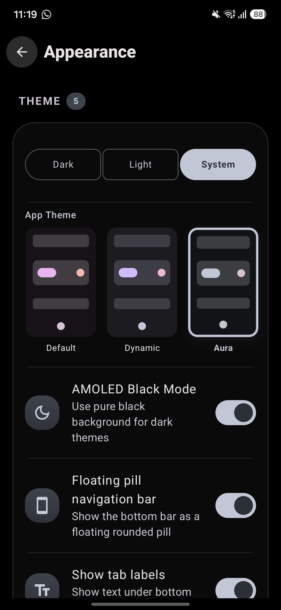

# AGENTS.md

## Project overview

`mpvium` is an Android video player fork based on `mpv-android` and
libmpv. It uses Kotlin, Jetpack Compose, Material 3, Room, Koin, and native
components for media playback and media analysis.

Tagline/philosophy: **Sane defaults, pro-level control** — opinionated for
everyday watching, fully customizable for pros.

The application package and namespace are:

- Application ID: `app.aryan447.mpvium`
- Android namespace: `app.aryan447.mpvium`
- Minimum SDK: 26
- Target/compile SDK: 36

The project is still under development. Do not describe it as bug-free or
production-perfect without running the relevant tests and build checks.

## Repository layout

- `app/` — main Android application source, resources, and native playback code.
- `app/src/main/java/app/aryan447/mpvium/` — Kotlin application source.
- `app/src/main/java/app/aryan447/mpvium/ui/mediainfo/` — MediaInfo UI/integration.
- `gradle/libs.versions.toml` — dependency and plugin versions.
- `.github/workflows/` — CI, preview, release, and deployment workflows.
- `fastlane/metadata/` — store metadata and screenshots.
- `CHANGELOG.md` — user-facing changelog; source of truth for release notes.
- `docs/` — static single-page site for GitHub Pages (`index.html` only, no build).

## MediaInfo dependency

The app consumes the separately maintained Android library repository:

`https://github.com/aryan447/mediainfoAndroid`

The dependency is served by JitPack and is declared in
`gradle/libs.versions.toml`:

```toml
mediainfo-lib = "com.github.aryan447:mediainfoAndroid:v1.0.0-fix"
```

The library repository must contain the matching Git tag `v1.0.0-fix`, and its
JitPack build must succeed before changing or testing this dependency.

The library's public Kotlin package is `net.mediaarea.mediainfo.lib`. Do not
rename that package merely to change the GitHub owner or repository identity.

## Build and verification

### Local download and installation policy

- Do not install or download software, dependencies, SDKs, JDKs, Gradle
  distributions, native toolchains, or other files on the local system unless
  the user explicitly authorizes it.
- Before running a command that may download or install anything, inspect the
  local environment and ask for explicit approval if the download is required.
- Prefer GitHub Actions for builds and verification that require downloads or
  unavailable Android tooling. Do not run the Gradle wrapper locally merely to
  test whether dependencies can be resolved without user approval.

Use the Gradle wrapper; do not require a global Gradle installation:

```bash
bash ./gradlew assembleStandardDebug
```

Useful variants:

```bash
bash ./gradlew assembleStandardRelease
bash ./gradlew assembleStandardPreview
```

The project documents JDK 17. The MediaInfo library currently targets Java/Kotlin
21, so verify the actual CI toolchain if compilation fails locally.

Before committing, run:

```bash
git diff --check
```

Build artifacts are written below `app/build/` and should not be committed.

## GitHub Actions

`.github/workflows/build.yml` builds the standard release APK on pull requests
and pushes to `main`, then uploads unsigned ABI-specific and universal APKs as
workflow artifacts.

Release and preview workflows may require repository signing secrets. Never add
keystores, passwords, tokens, or other credentials to the repository.

## Change guidelines

1. Keep changes focused and preserve existing user-facing behavior unless the
   task explicitly requests a behavior change.
2. Search the repository with `rg` before renaming identifiers or dependencies.
3. Prefer existing project patterns and components over introducing new ones.
4. Do not modify generated files or build outputs unless specifically required.
5. Be careful with native C/C++ and JNI changes; verify all supported ABIs.
6. When changing dependencies, update the version catalog and verify repository
   resolution through JitPack or CI.
7. Do not claim that the app is perfect. Report exactly which checks passed,
   failed, or could not run.
8. Attention to details is must. Match existing spacing, padding, corner
   radii, elevation, colors, typography, and iconography instead of
   introducing near-duplicate values. Reuse shared components, dimens,
   shapes, and string resources; verify alignment, insets (status,
   navigation, gesture areas), RTL mirroring, and light/dark themes
   before finishing any UI change.
9. Update `UNRELEASED.md` after every feature addition, change, or fix, as
   one short user-facing line under `Added`, `Changed`, or `Fixed`. When
   cutting a preview or stable release, rewrite those notes into
   `CHANGELOG.md` in the release-announcement style below and clear
   `UNRELEASED.md` again.

## Agent skills

Project-scoped agent instructions live in `.opencode/skills/`. Load the matching
one before working in that area:

| Skill | Use for |
| --- | --- |
| `build-verify` | Gradle variants and flags, CI, what may run locally, done-checks |
| `ui-conventions` | Compose screens, settings, tokens, motion, haptics, insets, RTL, strings |
| `playback-native` | mpv options, decoders, shaders, gestures, ABI packaging, the mpv AAR |
| `mediainfo` | `MediaInfoOps`, the media info screen, the JitPack MediaInfo dependency |
| `release-changelog` | CHANGELOG entries, version bumps, tags, fastlane, release workflows |
| `commit-messages` | Commit and PR wording that leads with measured outcomes |

`commit-messages` includes `scripts/check-commit-msg.sh`, which flags perf
subjects without a number and improvement claims without evidence.

## Development without local installation

GitHub Actions is the preferred fallback when the local machine lacks Android
SDK, NDK, CMake, or network access. Push the project and inspect the workflow
under the repository's **Actions** tab. Download generated APKs from the
workflow's **Artifacts** section.


# What's New

`CHANGELOG.md` holds the notes for the version being shipped, written as a
release announcement rather than a diff. `UNRELEASED.md` is the scratch pad
that feeds it.

## The workflow

1. While you work, add one short line per user-facing change to
   `UNRELEASED.md` under `Added`, `Changed`, or `Fixed`. These are raw
   material; do not polish them yet.
2. When cutting a preview (`v*-preview*`) or stable release (`v*`), clean
   `CHANGELOG.md` and rewrite the whole release in the style below. A clean
   file starts with `# mpvium <version>` — no leftover sections from the
   previous version.
3. Remove the lines you consumed from `UNRELEASED.md`, leaving the empty
   headings behind.
4. Paste the `CHANGELOG.md` body into the GitHub release; the workflows
   append checksums.

Older releases live in GitHub releases and git history, not in the file.

## The style

Write it the way Omarchy announces a release: a person telling you what
changed, most interesting first.

- **Open with the headline.** `# mpvium 1.5.0`, then one paragraph on what
  the release is about. Lead with the numbers when you have them ("two
  players", "five new tabs"), and close the intro with how to update.
- **One `##` section per headline feature**, in the order a user would care.
  Plain-language title (`## Audio arrives`, `## A player with two faces`),
  then one to three short paragraphs: what it is, where it lives, what it
  replaces. Prose, not bullets, and only one section per big idea.
- **Bold the name** of a feature the first time it appears, the way a product
  announcement would: `**Modern**`, `**Audio**`, `**Aura**`.
- **Name the path and the default.** Every feature says where to find it
  (`Settings → Appearance → Player Layout`) and what it does out of the box.
- **Say what it replaces.** "Cinema and Minimal move to Modern." Users need
  to know where the thing they used to tap went.
- **Screenshots are welcome.** Put one on its own line under the section it
  illustrates, repo-relative so GitHub renders it:

  ```html
  
  ```

  Portrait phone shots take `width="220"` so several fit in a row. Leave the
  width off landscape shots (players, wide screens) — they should span the
  text column and sit flush with the prose above and below.

  Always also copy the file to `website/public/screenshots/` — the site's
  changelog page serves images from there. For a GitHub release body, swap
  the relative path for the raw URL
  (`https://raw.githubusercontent.com/Aryan447/mpvium/main/docs/screenshots/…`),
  because release notes do not resolve repo-relative paths.
- **`## More features`** takes the smaller items as one-line bullets, each
  starting with a bold lead-in (`**Grid or list per tab**`,
  `**Periodic playback checkpoint**`).
- **`## New defaults`** collects everything that changed for existing users,
  because that is what they will notice first.
- **`## Fixes`** closes the post: dense, specific, one sentence each, naming
  the symptom the user saw rather than the mechanism behind it.
- **Voice**: second person, present tense, sentence case, American spelling,
  full stop at the end. "You no longer have to", never "the implementation
  was refactored".
- **No internals**: no file names, class names, identifiers, PR numbers, or
  commit hashes. Nobody should have to know what a `PlayerViewModel` is.

## Rules that never change

- User-facing only. CI, agent skills, dependencies, and invisible refactors
  stay out of both files.
- Every claim must be true and, where possible, measurable. Never say
  "faster" without saying what got faster.
- Keep sections in descending order of user interest; fixes go last even
  when they were most of the work.
- Short lines in `UNRELEASED.md`, full sentences in `CHANGELOG.md`.
- Update both files in the same change that alters user-visible behavior.

