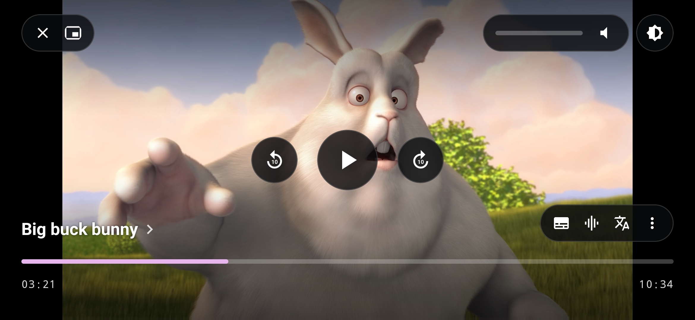
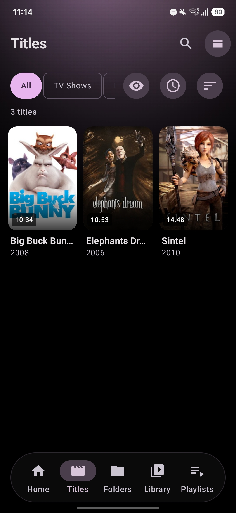
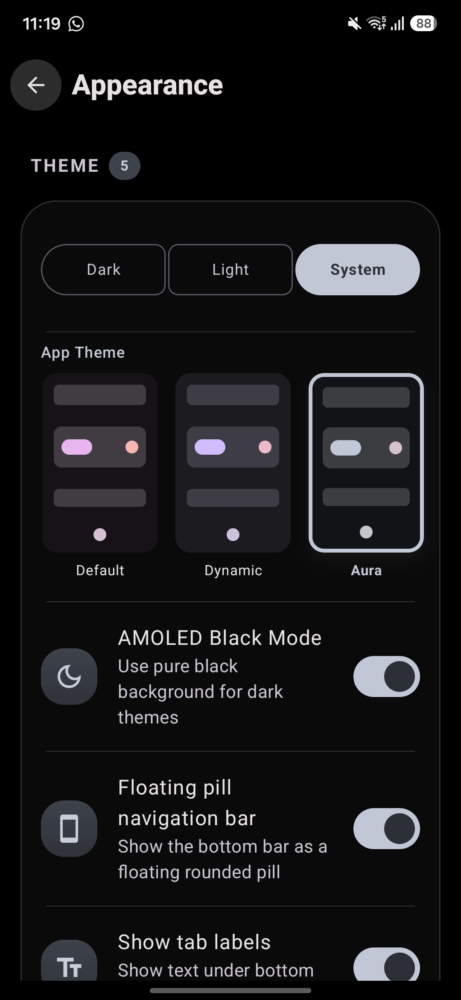
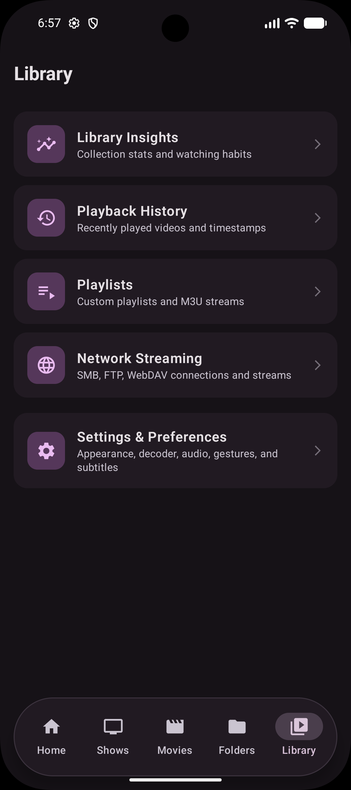
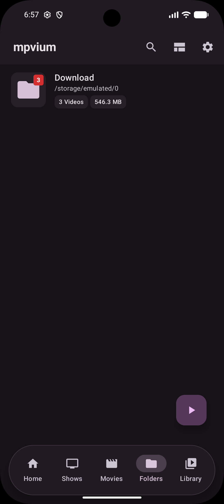
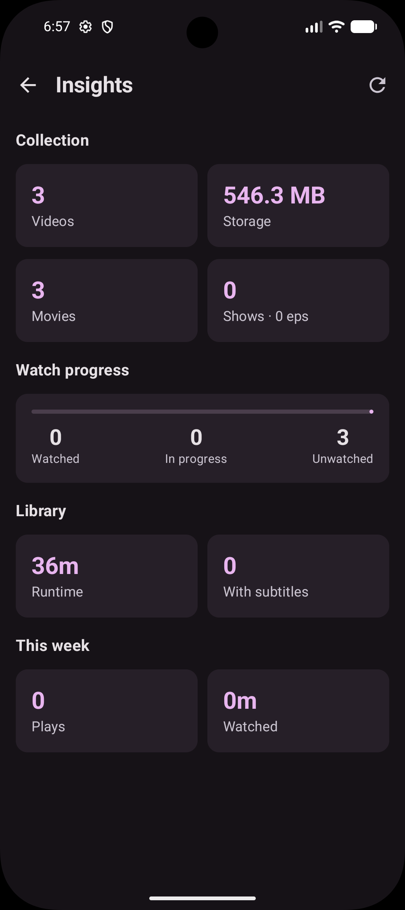
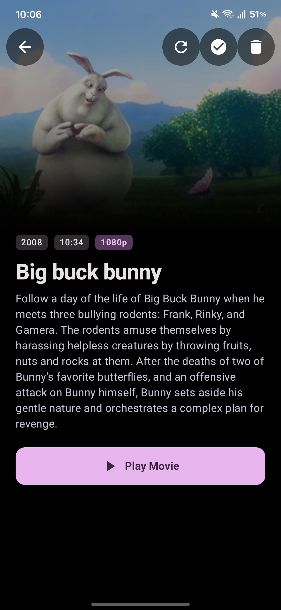

# mpvium 1.5.0
# The Evolution Update

mpvium 1.5.0 is the biggest release this project has shipped: more than seventy-five changes across the player, the library, and a brand-new audio side of the app. Video now has a second face built for the living room, audio finally lives in its own tab with books and lecture series in it, your own TV shows can be built from any folder, one tab holds everything you watch, and a theme borrows its colors from your library. Nearly every screen was rebuilt along the way, and the player spent the cycle hunting down seekbar jitter so you never see it again.

Already on mpvium? Open **About** and check for updates. New here? Grab the APK for your device and play something.

## A player with two faces

The glass-pill player you already know is now **Classic**, and beside it sits **Modern**, the new default. It leaves the video alone: a floating glass pill top-left with close and picture-in-picture, expandable **Volume & Brightness** controls top-right with a live percentage, circular transport controls floating in the center, a two-line title bottom-left (episode above series, with a chevron into the show), and a customizable actions pill bottom-right for subtitles, audio track, Explain, and the menu. The seekbar follows your theme, chapter dividers stay gated by settings, everything keeps clear of gesture navigation, and every control answers with a tap of haptics. It's under **Settings → Appearance → Player Layout**; anyone on the old Cinema or Minimal layouts moves over automatically, and the old glass-pill chrome is one tap away if you want it back.

Brightness now moves the way volume does. Swipe the left edge and the top-right capsule expands with the real percentage while volume shrinks to a round toggle icon, so both gestures read identically and you always know which one you're touching.

Seekbars in Modern come just like Classic in **Standard**, **Wavy**, and **Thick** — Standard by default, under **Settings → Appearance → Controls** — and the minimized volume and brightness icons swap to show which one is active during swipes, slider scrubs, and hardware volume presses, then snap back the moment you stop.

## Audio arrives

mpvium now has a real audio library. **Audio** is its own tab, scanning local music through MediaStore into **Albums**, **Artists**, and **All tracks**, with grid or list layouts, an album detail view, and queue playback. It never pollutes your video folders, it hides itself when there's no audio on the device, and one switch in Settings brings it back when there is. Browsing, playing, and the player itself are all built for audio: album artwork, title, artist, and a queue sheet, with video gestures out of the way.

Playback keeps going when you leave. **Background audio** runs through a media notification and lock-screen controls, and says so politely when notification permission is denied.

**Audiobooks** and **discourses** are grouped out of the box. Books group by folder and album with natural chapter ordering, resume from the exact saved part, and remember their own playback speed. Lectures group by speaker and collection, resume across parts, and show embedded or CUE chapters for each one. **Continue Listening** on Home picks up both, orderable and toggleable alongside your other home sections.

Album covers are resolved properly instead of left blank: embedded art first, then a politely rate-limited, keyless MusicBrainz and Cover Art Archive lookup, cached on disk per album and artist so it works offline, kept for as long as the album exists, and pruned when it's gone. If nothing turns up, a generated tile with the album's initials keeps the grid from looking broken.

## Your own TV shows

Not every series needs a scraper. **Custom series** let you build one from any videos: title, release year, poster, and drag-and-drop episode ordering with explicit season and episode numbers. Add one straight from selection mode in Folders and Files, where **Add to series…** sits next to Add to playlist, or from the **Create series** action in the Shows header — with real guidance when the screen is empty.

Once built, a custom series looks and behaves like any detected show: same detail screen, same playback, same progress. **Edit** and **Delete** are right there, and Delete removes only the grouping, never the files. Videos claimed by a custom series drop out of automatic scanning, so nothing shows up twice in TV shows or movies.

## One tab for everything you watch

Shows and movies now share a single **Titles** tab. A segment control across the top switches between All, TV Shows, and Movies; watch-state and duration sit beside it as dropdown buttons; sorting covers Name, Recently added, Rating, Longest, and Shortest; and the grid/list toggle works as it does everywhere else.

Prefer them apart? **Settings → Appearance → Bottom navigation** still splits TV Shows and Movies into their own tabs, each with its own visibility toggle. Launcher shortcuts keep working either way — the historical Movies slot now opens Titles with the Movies filter already applied.

## Aura

**Aura** is a content-driven theme, third in the picker after Default and Dynamic. Its accents and ambient glow adapt to the poster of whatever you were last watching — previewing titles as you browse series and movie detail screens — and it quietly falls back to a neutral identity when contrast or chroma checks say a poster would make a bad theme. Your library colors the app, but never at the cost of readability.

## Faster everywhere else

The library index now lives in a Room snapshot that refreshes incrementally, so changing tabs no longer means rescanning the device. Home, Shows, Movies, and Insights share one background scan instead of each starting their own.

Seeking got adaptive precision: exact jumps for short skips, keyframe jumps for long ones, so heavy media doesn't stall the decoder when you drag far ahead. And for anyone who wants more, **Lean seek cache** under **Settings → Advanced** deepens the demuxer cache around the playhead, sizing byte budgets from your memory class and bitrate, capped at a conservative 96 MB forward and 128 MB backward, with the live cache ranges drawn behind the seekbar rail.

## More features

- **Playlists** are a first-class bottom-navigation tab, on by default, with a direct create action when empty.
- **Grid or list per tab** across Shows, Movies, and Folders, remembered independently across restarts, with a tap-to-toggle icon in each top bar next to sort.
- **List rows** for shows and movies, with poster, title, year, and inline progress.
- **Movies length filter** is now a clock button with a dropdown next to sort — Any length, 30 min+, 1 h+, 1.5 h+ — and it fills while a threshold is active.
- **Automatic or manual scanning** for the library, under **Settings → Folders**.
- **Periodic playback checkpoint** saves progress while you watch, every 30 seconds by default (15 s, 30 s, 1 min, or 5 min under Settings → Player), and survives process kills, force stops, PiP, and background playback.
- **Settings search** jumps straight to the row you picked and tints it so you can see where you landed.
- **Metadata overrides**: edit title, release year, and cover art yourself for any movie or show through the system photo picker. Overrides work offline and survive rescans, refreshes, and cache migrations.
- **Subtitle scope** remembers position and scale per show or per movie instead of one global pair, with per-title reset from the subtitle sheet and **Clear all subtitle profiles** under Settings → Subtitles.
- **Chapter markers in the seekbar** are a toggle under **Settings → Appearance → Seekbar**.
- **Online subtitle search** now reads like a release, not a filename: a clean title, quality, source, codec, audio, edition, and release-group pills, a language badge, and a provider line. Added tracks show the same friendly label in the track list.
- **Bottom-navigation manager** lists all six tabs including Playlists, with individual toggles and protection against turning off the last one.

## New defaults

- **Modern** is the default player layout. Anyone who already chose Classic keeps it, and Cinema or Minimal users land on Modern.
- **Hold gesture** now defaults to Speed boost (2x) instead of Brightness / Volume.
- **Subtitle scope** defaults to Per-title, so position and scale are remembered per show or movie from the first play.
- **Volume slider style** defaults to Standard across gesture indicators and appearance settings.
- **Clean title style** defaults to Two lines, which suits Modern's episode headers best.
- **Decoder** now defaults to HW+ instead of HW.

## Fixes

- Seekbar and timer no longer dance or jump backwards on release in either player style: the target holds until playback confirms it, and Modern's section timers stay locked in step.
- Modern clean titles now respect the master **Clean titles** toggle and title-style choice, and episodes format as `S01:E02 "Episode Title"` above the series name instead of losing their numbers.
- Tracks play from the Audio tab again: opening an audio file now hands over the right permissions, and fallback paths no longer drop audio.
- The audio player's top bar is padded for the status bar and display cutout, so the "Now playing" header is never hidden under a punch-hole camera.
- Modern's seekbar no longer buzzes, releasing it while paused doesn't resume playback, and swiping up scrubs at 1x, 2x, 4x, or 8x with the same floating rate popup as Classic.
- Volume and brightness swipes hide Modern's on-screen controls instead of letting them collide with titles and action buttons.
- Hardware volume keys no longer draw a second slider over Modern's controls, and the top-right capsule shows the live percentage.
- Skip Intro and Skip Recap sit below the volume and brightness capsule in landscape instead of on top of it.
- The Audio tab appears in the bottom bar as soon as you enable it.
- Horizontal swipes no longer stretch the seekbar track or flatten its wavy line, and the thumb and timers hold still while you drag.
- Opening the player with **Lean seek cache** enabled no longer crashes.
- A second subtitle in the same language downloads as its own file and shows as its own track instead of overwriting the first.
- Online subtitle rows show per-result progress and ignore repeat taps while downloading.
- Playback position is saved from anywhere in the app — on pause, stop, track change, task removal, and memory pressure — and a good position is never overwritten with zero.
- Anime with years in the title (`Jujutsu Kaisen (2020) - 05.mkv`) is recognized as an episode instead of a movie.
- Multi-episode files (`S01E01E02`, `S01E01-E02`, `1x01-02`, `- 01-02`) parse to the first episode without leaking numbers into the title.
- Fansub release tags, CRC hashes, and decorative brackets no longer split one show into several entries.
- Subfolder naming like `Show/Season 2/01 - Title.mkv` and `Show/01x02.mkv` resolves show, season, and episode correctly.
- Shows mixing explicit `SxxExx` files with bare dash-numbered episodes stay one show instead of splitting in two.
- Numbers in movie titles (`1917 (2019)`, `2012 (2009)`, `Blade Runner 2049 (2017)`) stay in the title, with the year taken from parentheses; a bare year is never returned as a title.
- The Dark/Light/System selector spans its card and lines up with the theme previews.
- Choice rows and filter groups use the light segment-tick haptic instead of a long-press buzz.
- The center overlay and seekbar timestamps stay in sync past 15 seconds, and swipes land on the exact target instead of snapping back to an earlier keyframe.
- Exact seeks let hardware decoders drop intermediate frames while catching up, so long jumps land instead of stalling on slower chips.
